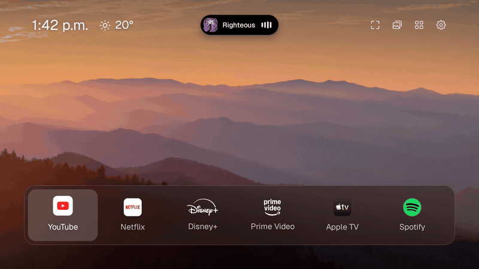
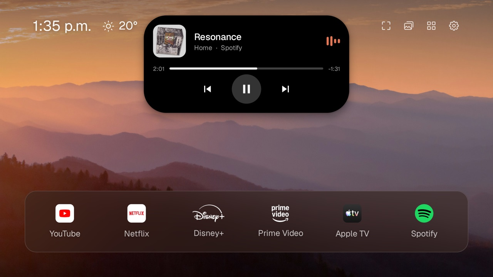
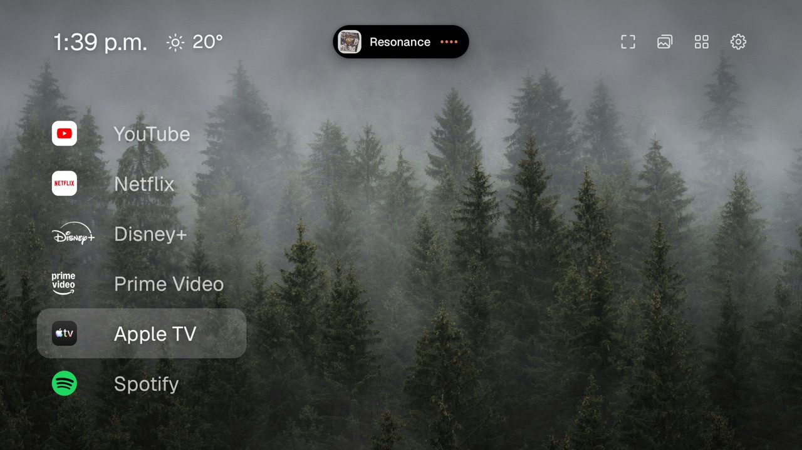
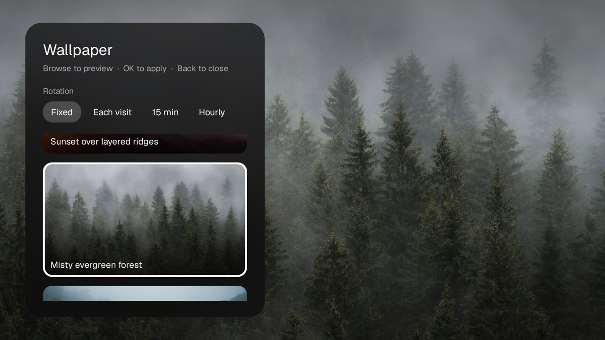
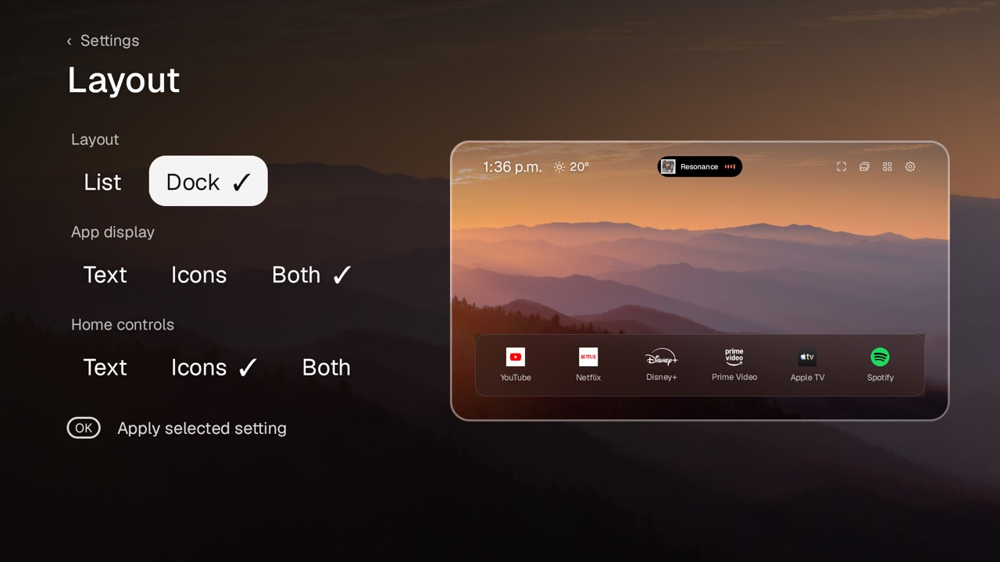
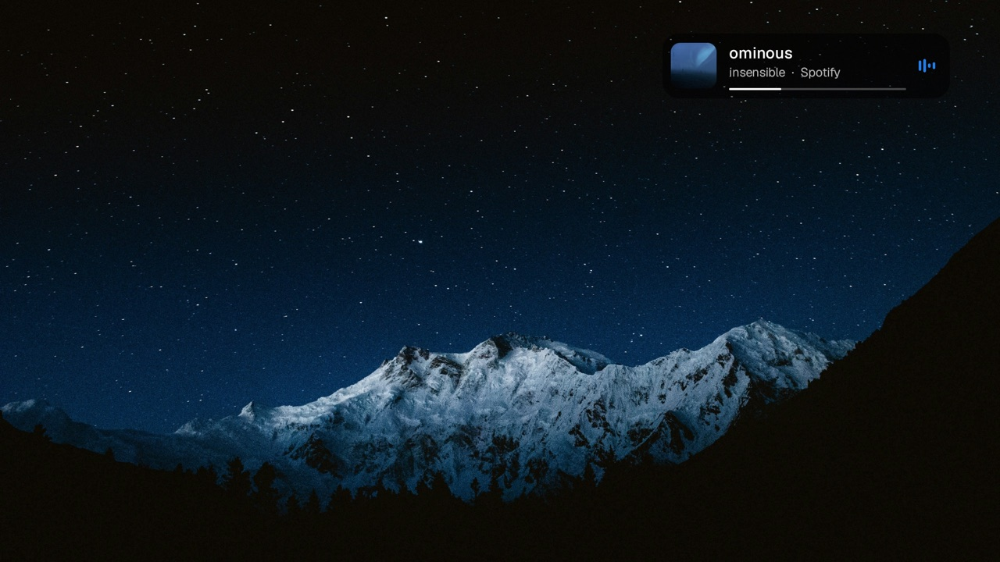

# Clean TV

A small, fast home screen for Google TV. Your apps, a photograph, the time and what's playing, and
nothing else: no ads, no recommendation rows, no background work. About 700 KB, no libraries.

The stock Google TV launcher stays installed as a backup, and every change has a one-line undo.

<p align="center"></p>

> **Tested on one device so far:** Chromecast with Google TV (4K, Android 14). See
> [Tested devices](#tested-devices) before trying it on anything else, and please report what happens.

## What you get

- **Home:** clock and weather, a frosted dock (or a list down the side), and controls for Art Mode,
  Wallpaper, All apps and Settings. App icons become clean white logos where the icon allows it.
- **Now playing:** a Dynamic Island-style pill that grows into a player with progress and controls,
  and peeks open when the track changes.
- **Wallpapers:** your own photos, with a live-preview picker and rotation (fixed, each visit, 15 min,
  hourly). The dock and panels take on each photo's colours.
- **Art Mode and screensaver:** just the photo, with a small clock and now playing.
- **Settings:** Background, Layout (List or Dock; Text, Icons or Both), Font, Focus (Glass or Type),
  Apps on Home, and Google TV (the stock home, Android TV settings). Each page previews the real
  home screen live.
- **Remote:** OK opens, hold OK for options (move, remove, app info, uninstall). Home opens Clean TV;
  holding Home still opens Google's side panel.

## Screenshots

| | |
| --- | --- |
|  |  |
| **Home:** clock, weather, now playing and a frosted dock | **Now playing:** press Up and the island becomes a player |
|  |  |
| **List layout:** apps down the side, the photo up front | **Wallpaper picker:** browse and the whole screen previews it |
|  |  |
| **Settings:** every change previews the real home screen | **Art Mode:** just the photo, plus what's playing |

<sub>Photos on Unsplash by Jonny James, Dejan Zakic and Haseeb Jamil (see [notices](THIRD_PARTY_NOTICES.md)). Clean TV ships without photos; you add your own.</sub>

## Quick start

**New to this? Follow the [step-by-step setup guide](SETUP.md).** It assumes no developer experience
and covers Mac, Linux and Windows. The short version:

You need a Mac or Linux computer on the same Wi-Fi as the TV.

```bash
brew install android-platform-tools   # or: sudo apt install adb
git clone https://github.com/tobiogun99/clean-tv.git && cd clean-tv
./tv.sh download                       # the ready-made app from Releases (or ./setup.sh && ./build.sh)
```

On the TV, turn on developer mode and wireless debugging:

1. **Settings > System > About**, click **Android TV OS build** seven times.
2. **Settings > System > Developer options > Wireless debugging**: on.
3. **Pair device with pairing code**, and leave the code on screen.

```bash
./tv.sh connect 123456   # the code from the TV
./tv.sh install
./tv.sh home-on          # Home button opens Clean TV
./tv.sh doctor           # checks everything is working
```

Optional:

```bash
./tv.sh wallpaper ~/Pictures/*.jpg   # your photos (resized for the TV on the way)
./tv.sh weather "Lisbon"             # weather next to the clock
./tv.sh nowplaying-on                # the now-playing island
./tv.sh screensaver-on               # your photos as the screensaver
./tv.sh debloat                      # turn off ambient-mode ads and other extras
./tv.sh speed                        # half-length system animations
```

**Undo everything** (put the TV back exactly as it was and uninstall):

```bash
./tv.sh reset
```

Each piece also has its own undo: `home-off`, `restore`, `speed-reset`, `screensaver-off`,
`nowplaying-off`. Run `./tv.sh help` for the full list.

## Permissions, and why

Clean TV asks for very little, but some of it sounds alarming, so plainly:

| What | Why | What it does **not** do |
| --- | --- | --- |
| **Accessibility service** ("Clean TV Home button") | Google TV sends the Home button to its own launcher no matter what. This catches the Home key so it opens Clean TV, and notices if the stock home screen comes up (at boot) so Clean TV can replace it. | It reads no screen content and no other keys' meaning; it only looks at Home and which app is in front. |
| **Notification listener** ("Clean TV now playing") | Android only shares "what's playing" with apps that hold this permission. | The listener is empty. Clean TV never reads notifications. |
| **Internet** | Weather from open-meteo.com. | Only the coordinates you set are sent. No analytics, no tracking, no accounts. |
| **Delete packages** | The "Uninstall" option in the hold-OK menu. Android still asks you to confirm. | Nothing on its own. |

Android 13+ won't let you switch on an accessibility service for a sideloaded app from the TV's
own menus ("restricted setting"). `./tv.sh home-on` does it over ADB, which is allowed.

## Fonts

Geist (default), Newsreader and the system font are included. To use a font you own but can't
redistribute, drop the file into `fonts-private/` and rebuild; it shows up in Settings > Font. That
folder is git-ignored. Don't share an APK that contains a font whose licence doesn't allow it.

## Customising

- `config.sh`: app ID, name and version. **Forks: change `APP_ID`** so your build doesn't clash
  with anyone else's, and bump `VERSION_CODE` for each release.
- Prefer Android Studio? Open the folder; `build.gradle` uses the same sources and `config.sh`.
  The Gradle build needs build-tools 36 (Android Studio installs it); `./build.sh` only needs 35.
- Release signing (Gradle, `build.sh` and CI) uses `keystore.jks` with the alias `cleantv`; set
  `KEYSTORE` / `KEYSTORE_PASS` to use another file or password. For GitHub releases, add your
  keystore as the `KEYSTORE_BASE64` and `KEYSTORE_PASS` repository secrets, or releases are signed
  with a throwaway key that updates can't install over.
- Prebuilt APKs are attached to [Releases](../../releases) by GitHub Actions.
- Working with a coding agent? Point it at [AGENTS.md](AGENTS.md) first.

## Tested devices

| Device | Android | Status |
| --- | --- | --- |
| Chromecast with Google TV (4K) | 14 | Works: everything above, tested with the physical remote. |
| Chromecast with Google TV (HD) | | Untested. Less memory (1.5 GB); 720p. |
| Google TV Streamer | | Untested. |
| Sony / TCL / Hisense Google TVs | various | Untested. They ship extra launchers, and the stock-home detection or `debloat` list may need changes. |
| Older Android TV (pre-Google TV) | 8+ | Untested. Home is handled differently; the Home-button service may not be needed. |
| Fire TV | Fire OS | Not expected to work as-is. |

Layouts use Android TV's standard 960×540 dp canvas, which TVs keep at any resolution, so 720p
and 4K screens should scale correctly, but that also needs confirming on real hardware.

Please open an issue with your model, Android version and `./tv.sh doctor` output.

## Connection problems

- **Wireless debugging keeps switching off.** Android turns it off after sleep or network changes.
  Once connected, `./tv.sh stay-connected` switches to a fixed port (5555) that stays on until the
  TV restarts: no more pairing codes. Anyone on your network could also try that port, though the
  TV asks you to approve new computers.
- **Pairing works but connecting times out.** If the TV answers `ping6` but not its IPv4 address,
  connect over IPv6: `adb mdns services` shows the port; connect to
  `"[fe80::…%en0]:PORT"` (the TV's link-local address, from `dns-sd -G v4v6 Android.local`).
  Restarting the router or TV usually fixes the underlying address problem.
- **Home stopped opening Clean TV after an update.** `./tv.sh install` re-arms it; otherwise
  `./tv.sh home-off && ./tv.sh home-on`. `./tv.sh doctor` tells you which.
- **Testing Home with `adb shell input keyevent`** doesn't work: injected keys skip the accessibility
  filter. Use the real remote.

## Credits

Settings structure, rotation and the wallpaper picker are adapted from
[CleanFrame](https://github.com/nthnclrk/CleanFrame) (MIT), a launcher for Samsung's Frame TV.
See [THIRD_PARTY_NOTICES.md](THIRD_PARTY_NOTICES.md). Clean TV is not affiliated with Google.

## Licence

[MIT](LICENSE).
